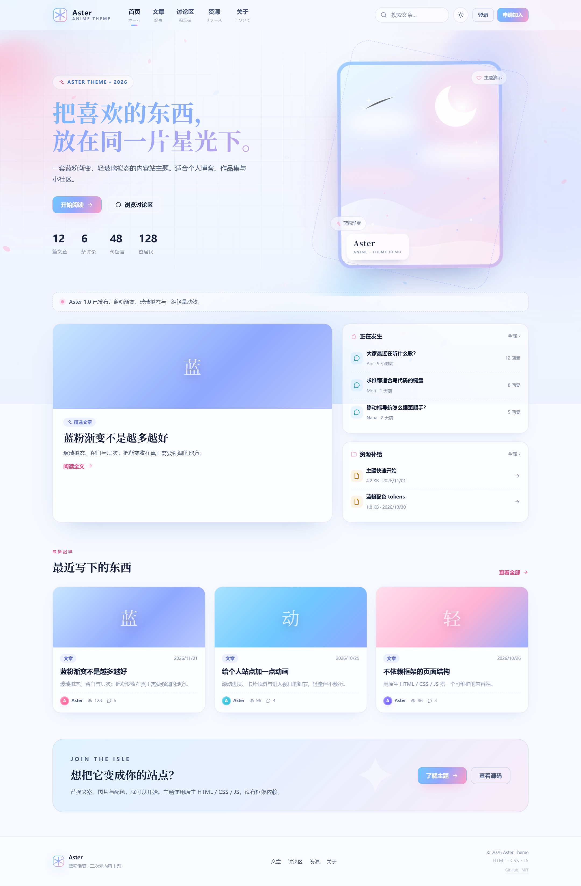
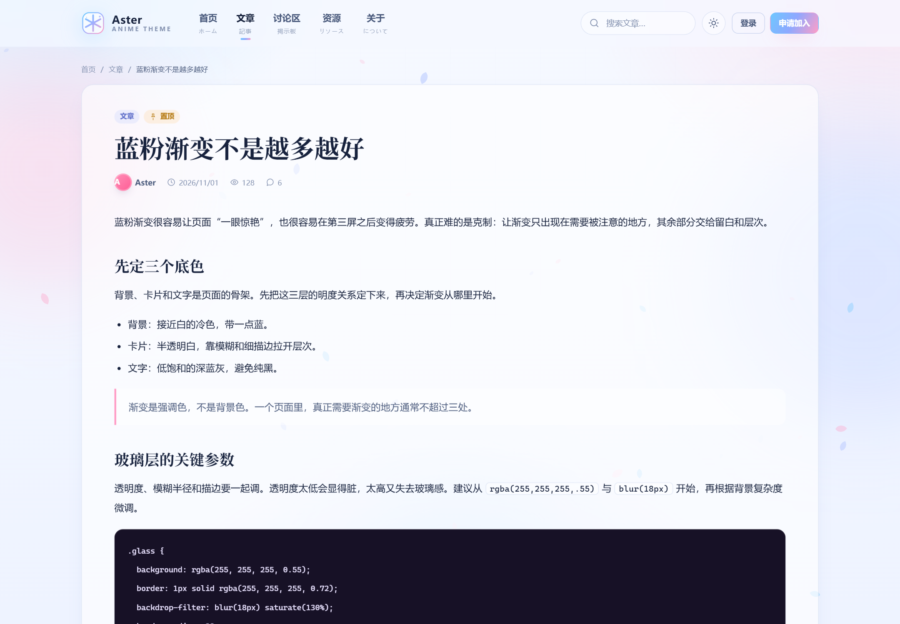
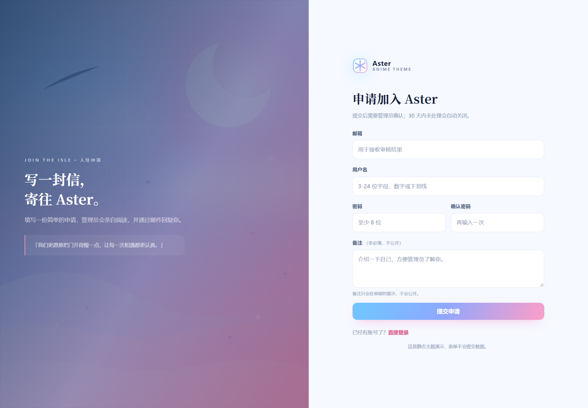
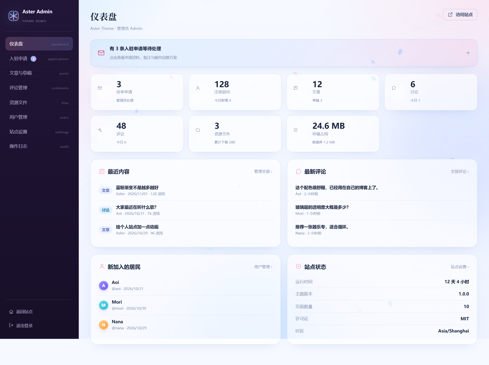
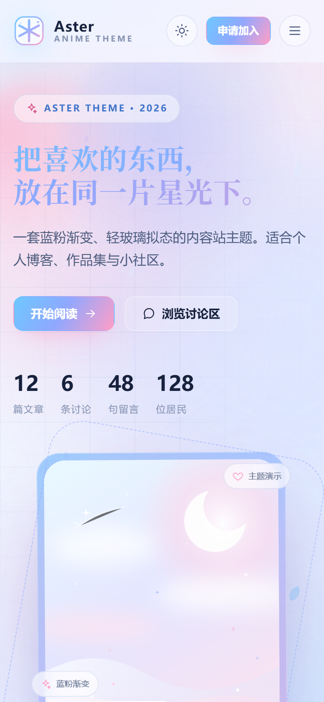

# Aster · 蓝粉渐变二次元内容主题

一套**浅色蓝粉渐变 + 轻玻璃拟态**的静态内容站主题，使用原生 HTML / CSS / JavaScript，无框架、无构建依赖。

适合个人博客、作品集、小型社区、二次元内容站，也可以作为后端模板的前端起点。

[在线预览](https://antaopan.github.io/aster-anime-theme/) · [快速开始](#快速开始) · [自定义](#自定义) · [MIT License](LICENSE)

---

## 预览



| 文章详情 | 申请页 |
| --- | --- |
|  |  |

| 后台仪表盘 | 移动端 |
| --- | --- |
|  |  |

---

## 特性

- **蓝粉渐变视觉**：`#6ec8ff → #8fa8ff → #ff9ec7`，浅色、低对比、留白充足
- **玻璃拟态**：导航、卡片、弹层、看板框均使用半透明 + 高斯模糊 + 细描边
- **明暗双主题**：本地记忆，无闪烁切换
- **轻量动效**：樱花粒子、滚动进度条、回到顶部、进入视口显现、卡片 3D 倾斜、数字滚动、渐变流动、页面淡入
- **完整页面**：首页、文章列表、文章详情、讨论区、讨论详情、资源、关于、登录、申请、后台仪表盘
- **响应式**：桌面 / 平板 / 手机
- **零依赖**：不需要 npm 安装依赖即可浏览；`npm run dev` 只是启动一个静态文件服务器
- **可访问性**：键盘导航、跳过链接、`prefers-reduced-motion` 支持、语义化标签
- **MIT License**：可商用、可修改、可分发

---

## 快速开始

### 方式一：直接打开

```bash
git clone https://github.com/antaopan/aster-anime-theme.git
cd aster-anime-theme
```

直接双击 `index.html` 即可浏览。部分浏览器对 `file://` 下的 SVG / 字体加载有差异，建议用本地服务器。

### 方式二：本地服务器

需要 Node.js 18+：

```bash
npm run dev
```

打开 <http://127.0.0.1:5173>。

也可以用 Python：

```bash
python -m http.server 5173
```

> 示例页是**纯静态**的。所有表单都带有 `data-demo="true"` 保护，提交时会提示“静态演示”，不会发送数据。

---

## 目录结构

```text
aster-anime-theme/
├─ index.html              # 首页
├─ articles.html           # 文章列表
├─ post.html               # 文章详情
├─ discussions.html        # 讨论区
├─ discussion.html         # 讨论详情
├─ files.html              # 资源列表
├─ about.html              # 关于
├─ login.html              # 登录
├─ apply.html              # 申请加入
├─ admin.html              # 后台仪表盘示例
├─ assets/
│  ├─ css/theme.css        # 全部样式与设计 token
│  ├─ js/theme.js          # 主题、导航、动效、表单增强
│  ├─ js/petals.js         # 樱花 Canvas
│  └─ img/
│     ├─ logo.svg
│     ├─ favicon.svg
│     └─ hero-art.svg      # 抽象星空插画（可替换）
├─ docs/
│  ├─ integration.md       # 接入后端 / 模板引擎
│  └─ palette.md           # 配色、字体、圆角与动效参数
├─ screenshots/
├─ scripts/serve.mjs
├─ package.json
├─ LICENSE
└─ NOTICE.md
```

---

## 页面

| 页面 | 文件 | 说明 |
| --- | --- | --- |
| 首页 | `index.html` | 主视觉、精选文章、正在发生、资源补给、加入区 |
| 文章 | `articles.html` | 搜索、标签筛选、卡片网格、分页 |
| 文章详情 | `post.html` | 正文排版、代码块、引用、作者卡、评论 |
| 讨论区 | `discussions.html` | 讨论卡片与标签 |
| 讨论详情 | `discussion.html` | 帖子正文与回复 |
| 资源 | `files.html` | 文件列表、大小 / 日期 / 下载数 |
| 关于 | `about.html` | 主题介绍、配色 token、许可 |
| 登录 | `login.html` | 左右分栏登录页 |
| 申请 | `apply.html` | 邮箱 / 用户名 / 密码 / 备注 |
| 后台 | `admin.html` | 侧栏、统计卡、最近内容、站点状态 |

---

## 自定义

### 1. 品牌名

全局搜索 `Aster`，替换为你的站点名。至少修改：

- 每个页面顶部 `.brand-text` 与页脚
- `<title>` 与 `meta description`
- `assets/img/logo.svg`、`favicon.svg`

### 2. 配色

打开 `assets/css/theme.css`，修改 `:root` 与 `[data-theme="dark"]` 中的 token：

```css
:root {
  --cyan: #6ec8ff;
  --purple: #8fa8ff;
  --pink: #ff9ec7;
  --bg: #f6f9ff;
  --ink: #1b2740;
  --grad: linear-gradient(120deg, #6ec8ff, #8fa8ff 52%, #ff9ec7);
}
```

完整色板见 [`docs/palette.md`](docs/palette.md)。

### 3. 主视觉插画

替换 `assets/img/hero-art.svg` 即可。保持竖版比例（建议 `420 × 520`）效果最佳。

首页、登录页、申请页共用这张图；也可以在 `login.html` / `apply.html` 中换成不同的图。

### 4. 接入后端

示例页的 HTML 结构可以直接复用。需要处理：

1. 删除 `<body data-demo="true">` 中的 `data-demo`；
2. 删除页面底部的 `.demo-badge`；
3. 把表单的 `action="#"` 改成真实接口；
4. 用后端模板替换文章、评论、统计等静态内容。

更完整的接入说明见 [`docs/integration.md`](docs/integration.md)。

### 5. 动效

`assets/js/theme.js` 中：

- `.post-card` 的 3D 倾斜：搜索 `card tilt`
- 进入视口显现：搜索 `reveal on scroll`
- 滚动进度 / 回到顶部：搜索 `scroll progress`
- 明暗主题：搜索 `theme`

所有非必要动效都会在 `prefers-reduced-motion: reduce` 下关闭。

---

## 部署

### GitHub Pages

仓库已包含 `.github/workflows/pages.yml`。推送到 `main` 后：

1. 打开仓库 **Settings → Pages**；
2. Source 选择 **GitHub Actions**；
3. 等待 `Deploy theme demo to Pages` 工作流完成。

站点地址：`https://<username>.github.io/aster-anime-theme/`

### 静态托管

把整个目录上传到 Netlify、Vercel、Cloudflare Pages 或任意静态服务器即可，不需要构建命令。

---

## 浏览器支持

- Chrome / Edge 111+
- Firefox 113+
- Safari 16.4+

玻璃拟态、`backdrop-filter`、CSS 变量、`color-mix` 等特性在旧浏览器中会降级为纯色背景，不影响阅读。

---

## 可访问性

- 跳过链接、可见焦点、语义化地标
- 键盘可操作的导航与弹层
- 图片提供 `alt`
- 支持 `prefers-reduced-motion`
- 正文对比度满足 WCAG AA（浅色背景）

---

## License

[MIT](LICENSE) © 2026 Aster Theme contributors

示例中的插画、Logo 与文案均为原创或虚构内容；详见 [NOTICE.md](NOTICE.md)。
